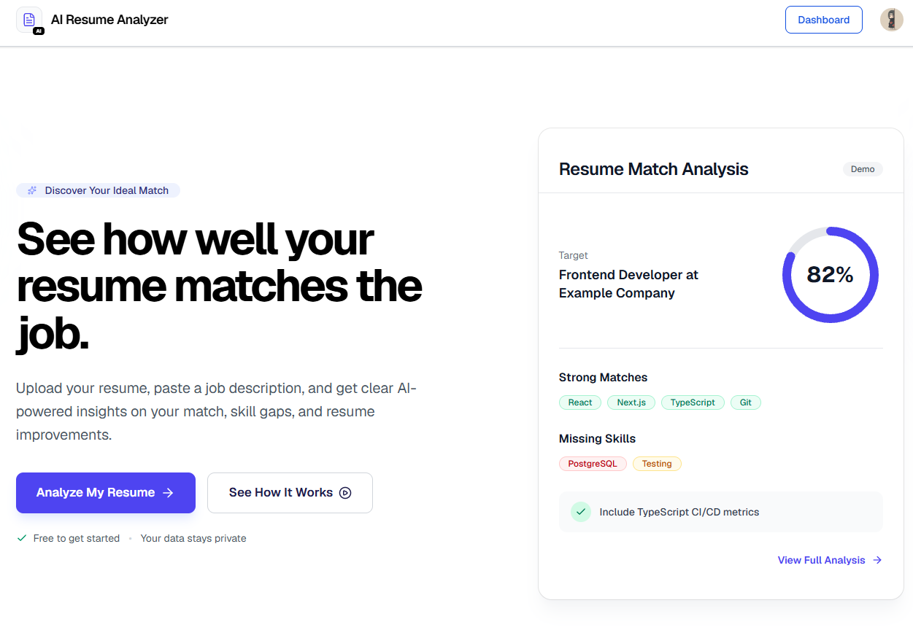
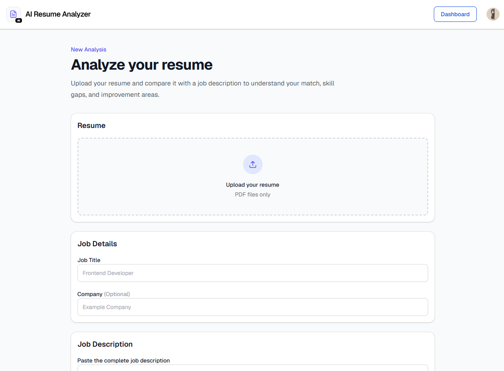
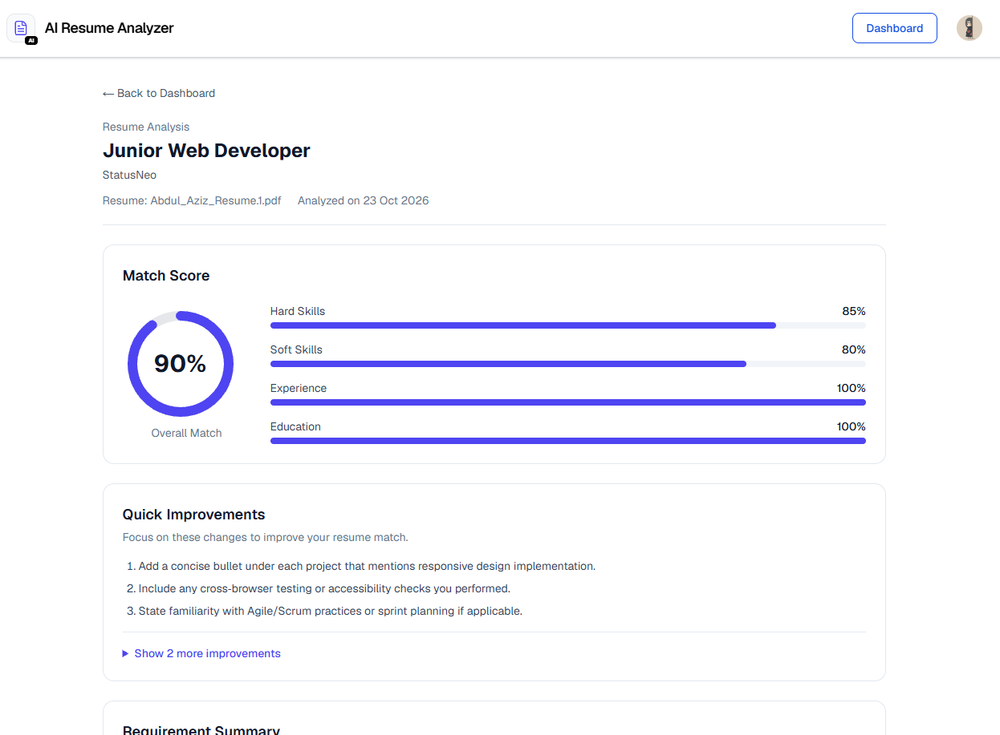
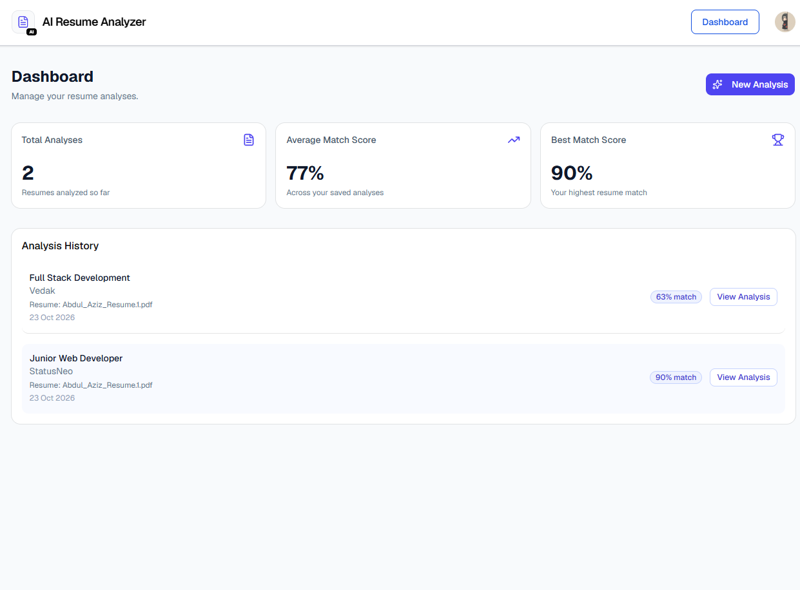
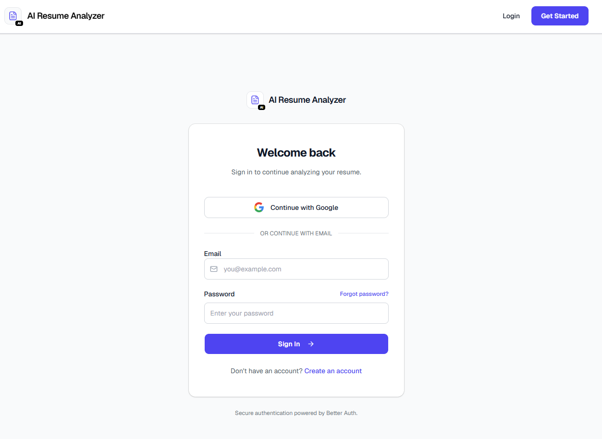

# AI Resume Analyzer

An AI-powered resume analyzer that helps job seekers evaluate how well their resumes match a target job description. Get an overall match score, identify missing keywords and skills, discover skill gaps, and receive actionable recommendations to improve your resume.

**Live Demo:** [View Live Application](YOUR_DEPLOYED_WEBSITE_URL)

**Repository:** [View Source Code](https://github.com/AbdulAzizDevIn/AI-Resume-Analyzer)

## Overview

AI Resume Analyzer helps job seekers identify the strengths and weaknesses of their resumes for a specific job opportunity. Upload a PDF resume, provide a job description, and receive an AI-generated analysis with match scores, keyword insights, skill gaps, and improvement suggestions.

## Features

- **AI-Powered Resume Analysis:** Compare a resume against a target job description.
- **PDF Resume Upload:** Upload a resume in PDF format for analysis.
- **Resume Match Score:** View an overall score representing the resume's match with the target role.
- **Keyword Analysis:** Identify matched keywords, missing skills, and additional relevant skills.
- **Skill Gap Analysis:** Discover gaps in skills, experience, and qualifications.
- **Actionable Recommendations:** Get practical suggestions and quick fixes to improve a resume.
- **Detailed Analysis Results:** Review category scores, matched and missing requirements, and supporting resume evidence.
- **Authentication:** Sign up, sign in, and access protected pages.
- **Google OAuth:** Sign in using Google.
- **Personal Dashboard:** View total analyses, average match score, and best match score.
- **Analysis History:** Review previous analyses and access detailed results.
- **Load More:** Load additional analysis history without navigating to another page.
- **Responsive Design:** Use the application across desktop, tablet, and mobile screens.

## Screenshots

Add screenshots of the actual application to `public/screenshots/`. Use representative screenshots that demonstrate the main workflow.

### Landing Page



### Resume Analysis Form



### Analysis Results



### Dashboard



### Authentication




## Tech Stack

### Frontend

- Next.js 16
- React 19
- TypeScript
- Tailwind CSS 4
- shadcn/ui
- Lucide React

### Backend and Database

- Next.js App Router and Route Handlers
- Prisma ORM 7
- PostgreSQL
- Better Auth

### AI and Data Processing

- Groq SDK
- Zod
- pdf-parse

## Getting Started

Follow these steps to run the project locally.

### Prerequisites

Make sure you have the following installed:

- Node.js, compatible with the project's Next.js version
- npm
- PostgreSQL
- A Groq API key

Google OAuth credentials are also required if you want to enable Google sign-in locally.

### 1. Clone the Repository

```bash
git clone YOUR_GITHUB_REPOSITORY_URL
cd ai-resume-analyzer
```

Replace the repository URL and directory name with the actual values for your project.

### 2. Install Dependencies

```bash
npm install
```

### 3. Configure Environment Variables

Create a `.env` file in the project root.

Configure the environment variables required by your application:

```env
DATABASE_URL="your_postgresql_connection_string"
GROQ_API_KEY="your_groq_api_key"
BETTER_AUTH_SECRET="your_auth_secret"
BETTER_AUTH_URL="http://localhost:3000"

GOOGLE_CLIENT_ID="your_google_client_id"
GOOGLE_CLIENT_SECRET="your_google_client_secret"
```

Use the exact variable names expected by your application. Configure Google OAuth credentials and callback URLs correctly if Google sign-in is enabled.

**Security note:** Never commit your `.env` file, API keys, database credentials, or authentication secrets to GitHub.

### 4. Set Up the Database

Generate the Prisma Client:

```bash
npx prisma generate
```

Apply the existing database migrations to your development database:

```bash
npx prisma migrate dev
```

Ensure that your PostgreSQL database is running and `DATABASE_URL` points to the correct database.

### 5. Start the Development Server

```bash
npm run dev
```

Open [http://localhost:3000](http://localhost:3000) in your browser.

## How It Works

1. Create an account or sign in.
2. Upload your resume in PDF format.
3. Enter the target job title and job description.
4. Optionally provide the company name.
5. Run the AI-powered analysis.
6. Review the match score, keyword analysis, skill gaps, and recommendations.
7. Visit the dashboard to review previous analyses.
8. Open an earlier analysis to view its detailed results.

## Project Structure

```text
ai-resume-analyzer/
├── prisma/
│   ├── migrations/
│   └── schema.prisma
├── public/
│   └── screenshots/
├── src/
│   ├── app/
│   │   ├── analyze/
│   │   ├── api/
│   │   │   ├── analyze/
│   │   │   ├── auth/
│   │   │   └── dashboard/
│   │   ├── dashboard/
│   │   ├── sign-in/
│   │   ├── sign-up/
│   │   ├── globals.css
│   │   ├── layout.tsx
│   │   └── page.tsx
│   ├── components/
│   │   ├── ui/
│   │   ├── match-score-ring.tsx
│   │   └── navbar.tsx
│   ├── lib/
│   │   ├── auth/
│   │   ├── ai-analyzer.ts
│   │   ├── ai-prompt.ts
│   │   ├── ai-schema.ts
│   │   ├── groq.ts
│   │   ├── prisma.ts
│   │   ├── score.ts
│   │   └── utils.ts
│   └── proxy.ts
├── .env.example
├── .gitignore
├── package.json
├── prisma.config.ts
├── README.md
└── tsconfig.json
```

This is a simplified overview. The exact structure may vary as the project evolves.

## Security and Responsible Use

- Keep API keys, database credentials, and authentication secrets private.
- Ensure users can access only their own resumes and analysis results.
- Avoid placing personal or confidential resume data in public screenshots.
- Use dummy data for demonstrations and testing.
- Treat AI-generated scores and recommendations as guidance rather than guarantees of hiring success.

## Future Improvements

Potential areas for future development include:

- Downloadable analysis reports.
- Additional resume formats.
- More detailed job-specific skill recommendations.
- Improved analysis history and filtering.

## Author

**Abdul Aziz**

- **GitHub:** [AbdulAzizDevIn](https://github.com/AbdulAzizDevIn)
- **Portfolio:** [abdulazizdev.in](https://abdulazizdev.in)
